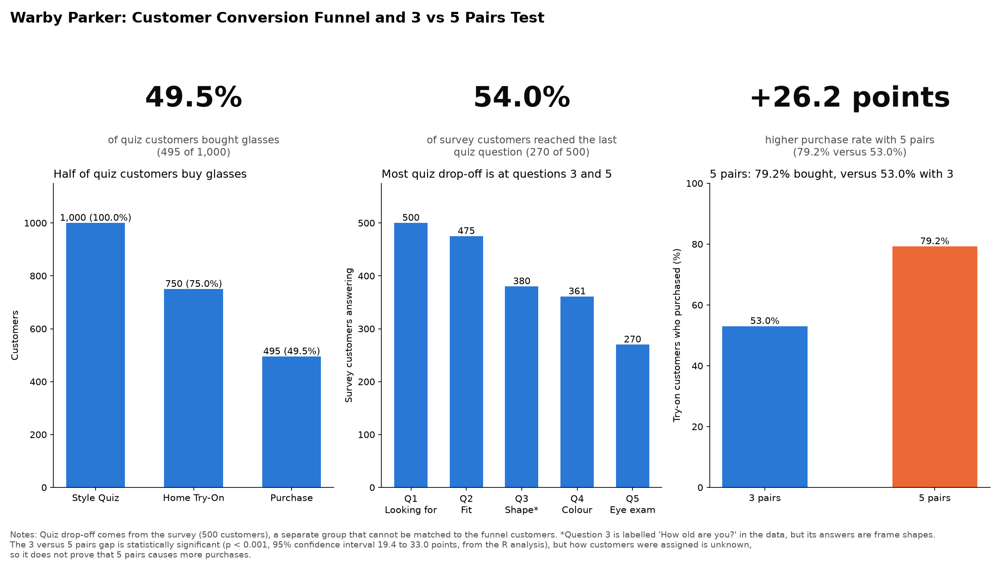
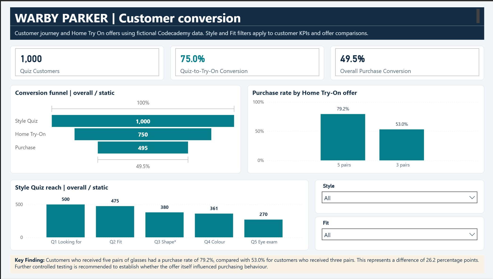
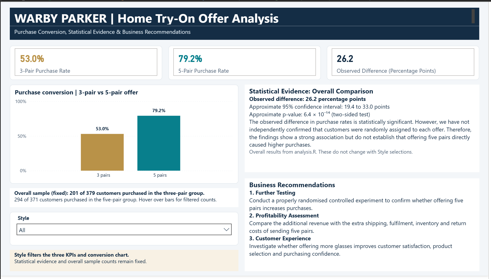

# Warby Parker: Customer Conversion Funnel and A/B Test

An end-to-end analysis of a fictional Warby Parker customer journey, using **SQL, Python, R, Power BI and DAX**.
It finds where customers drop off, measures conversion from the Style Quiz to Home Try-On to Purchase,
and compares purchase rates for customers offered **five pairs of glasses instead of three**. Statistical testing evaluates the observed difference; the available data does not establish causation.

The image above is the static dashboard generated by the Python notebook. The completed two-page Power BI report is available as an [editable PBIP project](powerbi/Warby_Parker_Dashboard.pbip). Both pages have been visually verified in Power BI Desktop by the project author. The Power BI screenshots below show readable KPI labels and cleared slicers.

## Key findings

| Question | Result |
|---|---|
| How many quiz customers buy glasses? | **49.5%** (495 of 1,000). 750 received a home try-on box (75.0%), and 66.0% of those bought. |
| Where do customers leave the quiz? | Survey customers fall from 500 at question 1 to 270 at question 5. The biggest losses are at question 3 (20.0%) and question 5 (25.2%). |
| Does the number of pairs matter? | 5 pairs: **79.2%** bought (294 of 371). 3 pairs: **53.0%** bought (201 of 379). |
| Is the observed difference statistically significant? | The gap is **26.2 percentage points**, with an approximate 95% confidence interval of **19.4 to 33.0 points** and a two-sided p-value of **6.4e-14**. This supports an association between offer size and purchases under the test assumptions; it does not prove that the offer caused the difference. |
| Is it worth it? | Each box with 5 pairs brought in 28.96 more purchase value (89.03 versus 60.07). Average prices are the same, so the gain comes from more buyers. This is revenue, not profit. |

## Recommendations

1. **Run a properly randomised test of the five-pair offer**, and compare additional revenue with shipping, fulfilment, inventory and return costs before deciding whether to expand it.
2. **Review quiz questions 3 and 5**, which lose the most customers. Fix the question 3 label and test an optional or moved question 5.
3. **Investigate customers who skip the style question.** None of the 69 who received a box bought.
4. **Improve the data:** record how customers are assigned to 3 or 5 pairs, use one customer ID in every table, and correct the question 3 label.

## Limitations

- **Causation is not proven.** The data does not say how customers were given 3 or 5 pairs. The two groups have a similar mix of quiz answers, which is reassuring but is not proof of random assignment.
- **Cost is not included.** The data has prices but no costs or margins.
- **The survey cannot be linked to the funnel.** None of the 500 survey customer IDs match the quiz customers, so quiz drop-off describes a separate group.
- **Survey question 3 looks mislabelled.** It is labelled "How old are you?", but its answers are frame shapes.
- The data is fictional and comes from one time period.

## Power BI dashboard

Both pages use a 1280 x 720 canvas with navy headers, teal charts, white backgrounds and gold accents.

*Page 1: Customer conversion. The overall view shows 1,000 quiz customers, 750 Home Try-On customers and 495 purchases, with 49.5% overall purchase conversion. The funnel and quiz-reach summaries remain static.*

*Page 2: Home Try-On Offer Analysis. Purchase rates are 53.0% for three pairs and 79.2% for five pairs, an observed difference of 26.2 percentage points. Overall statistical results stay fixed when Style filters the KPIs and chart. Random assignment is unconfirmed, so the findings do not establish causation.*

| Page | Purpose and content | Main findings |
|---|---|---|
| **Page 1: Customer conversion** | Summarises the customer journey with three KPI cards, an overall conversion funnel, Style Quiz Reach, an offer comparison, and Style/Fit slicers. | **1,000** quiz customers, **750** Home Try-On customers and **495** purchases. Quiz-to-try-on conversion is **75.0%** and overall purchase conversion is **49.5%**. |
| **Page 2: Home Try-On Offer Analysis** | Compares three-pair and five-pair purchase rates, with dynamic KPIs, a comparison chart, a Style slicer, overall statistical evidence and business recommendations. | Three pairs: **201/379 customers (53.0%)**. Five pairs: **294/371 customers (79.2%)**. The observed difference is **26.2 percentage points**. |

Style and Fit filter Page 1 customer KPIs and the offer comparison. The overall funnel and quiz-reach charts are fixed summary tables and remain static. The survey is a separate cohort, so its reach counts must not be treated as a subset of the 1,000 quiz customers.

On Page 2, Style filters the KPIs and comparison chart. The confidence interval, p-value and overall sample counts remain fixed and are labelled accordingly. Customers with no try-on box are excluded from the offer comparison. The difference card displays `+26.2` with the label **Observed Difference (Percentage Points)**, rather than implying a 26.2% relative increase.

Random assignment has not been independently confirmed. These results show a strong association, but they do not establish that offering five pairs directly caused higher purchases.

See the [Power BI guide](powerbi/POWER_BI_GUIDE.md) for opening the project and reconnecting its CSV sources, and the [publication checklist](powerbi/PUBLICATION_CHECKLIST.md) for remaining portability and screenshot tasks.

## Tools and methods used

| Tool | Role in the project |
|---|---|
| **SQL / SQLite** | Inspects data and calculates quiz drop-off, joined customer funnels and offer-level summaries using CTEs, `LEFT JOIN` and `GROUP BY`. |
| **Python** | Uses pandas for validation and exploratory analysis, and matplotlib/seaborn for visualisation. Exports the four Power BI CSV tables. |
| **R** | Uses dplyr, ggplot2 and base R `prop.test()` for descriptive analysis, a two-sided two-proportion test, confidence intervals and effect sizes. |
| **Power BI Desktop** | Presents the results in two interactive dashboard pages using an Import semantic model. |
| **DAX** | Provides ten semantic-model measures for customer counts, conversion rates and offer comparisons. A report-only expression scales the existing rate-difference measure into percentage points without changing the model. |
| **Microsoft Power BI authoring tools** | Uses the `powerbi-report-cli` skill and Report Authoring CLI v0.5.0 for PBIR editing, formatting metadata and validation. The CLI is optional for viewing the report in Desktop. |

## Project structure

| Path | What it is |
|---|---|
| `analysis.ipynb` | Python analysis: data inspection, cleaning checks, SQLite database, exploratory analysis, interpretation, dashboard and recommendations |
| `analysis.sql` | SQL queries: quiz drop-off, full funnel and 3 versus 5 pairs, with CTEs, `LEFT JOIN` and `GROUP BY` |
| `analysis.R` | R statistical analysis: hypotheses, two-proportion test, confidence intervals, effect sizes and a chart |
| `dashboard.png` | One-page dashboard, created by the notebook |
| `data/` | The four original CSV files (no header row, never modified) |
| `powerbi/` | Four CSV exports, the editable PBIP report and semantic model, an opening/portability guide, and a publication checklist |
| `CLAUDE.md`, `AGENTS.md` | Working instructions for the AI assistant used on this project |

## How to run

1. **Python:** open `analysis.ipynb` in VS Code, select a Python 3 kernel and choose **Run All**. This creates `warby_parker.db`, `dashboard.png` and the files in `powerbi/`.
2. **SQL:** after step 1, run `sqlite3 -header -column warby_parker.db < analysis.sql`, or open `analysis.sql` in a SQLite viewer connected to `warby_parker.db`.
3. **R:** set the working directory to the project folder and run `Rscript analysis.R`, or run the script in VS Code.
4. **Power BI:** open `powerbi/Warby_Parker_Dashboard.pbip` in Power BI Desktop and set the **CSV Folder** Power Query Text parameter to the absolute path of your checkout's `powerbi` directory. All four CSV queries reuse it. Close & Apply and load/refresh the local data when ready. Follow [the portability instructions](powerbi/POWER_BI_GUIDE.md#open-the-report-on-another-computer); relative CSV paths are not automatically resolved from the PBIP.

The saved `CSV Folder` value, `C:\YOUR_CHECKOUT\warby-parker-funnel-analysis\powerbi`, is a placeholder. Replace it through **Transform data > Manage Parameters** before refreshing. Refresh may fail until a real absolute folder containing all four exported CSVs is configured. The project has not been refreshed successfully with the placeholder, and it does not automatically locate a cloned repository.

Run Python and R from the repository root. Python requires pandas, matplotlib, seaborn and a Jupyter kernel; SQLite support comes from Python's standard library. R requires dplyr and ggplot2. Power BI Desktop is a separate Windows application. Viewing the local PBIP does not require publishing to Power BI Service.

## Methods

- **Data checks:** no duplicate rows or customers, no missing values, customer IDs match step by step across quiz, try-on and purchase, and joins keep 1,000 rows.
- **Funnel:** `LEFT JOIN` from every quiz customer, so customers who stop early are still counted.
- **A/B test:** two-sided two-proportion test at the 0.05 level, with a confidence interval for the difference, rate ratio and odds ratio. A second test without the "I'm not sure" style customers gives the same conclusion (58.8% versus 86.7%).
- **Dashboards:** a static matplotlib summary plus a completed two-page Power BI report. The report has four Import tables, one relationship and ten DAX measures. The statistical test remains in `analysis.R`; the Power BI statistical summaries are fixed overall results.

## Data

Four fictional Warby Parker datasets from a Codecademy exercise: `survey.csv`, `quiz.csv`, `home_try_on.csv` and `purchase.csv`.
The files have no column names. The notebook names the columns after inspecting the values:

| File | Columns |
|---|---|
| `survey.csv` | question, user_id, response |
| `quiz.csv` | user_id, style, fit, shape, color |
| `home_try_on.csv` | user_id, number_of_pairs, address |
| `purchase.csv` | user_id, product_id, style, model_name, color, price |

## Recorded analysis environment

Python 3.14.6 (pandas 3.0.3, numpy 2.4.6, matplotlib 3.11.0, seaborn 0.13.2), R 4.6.2 (dplyr 1.2.1, ggplot2 4.0.4) and SQLite 3.54.0.
`warby_parker.db` is created by the notebook and is not stored in the repository.

## Project workflow

- [x] 1. Business understanding and project objectives
- [x] 2. Development environment setup
- [x] 3. Data acquisition and initial inspection
- [x] 4. Data cleaning and quality validation
- [x] 5. SQL funnel analysis
- [x] 6. Python exploratory data analysis
- [x] 7. R statistical inference and A/B testing
- [x] 8. Business interpretation
- [x] 9. Data visualisation and dashboard development
- [x] 10. Business recommendations
- [x] 11. Executive presentation (slide deck, shared separately)
- [ ] 12. Final GitHub portfolio publication: both PNG screenshots and a non-personal CSV folder placeholder are prepared; final review and commit/push remain outstanding. Every clone requires manual folder configuration before data refresh. See the publication checklist.
